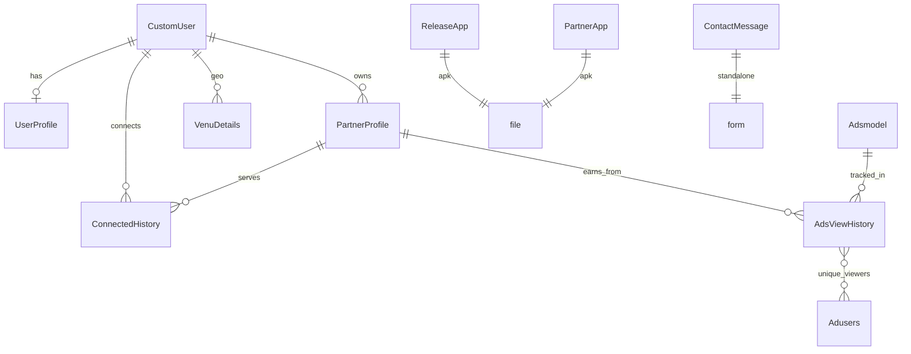

# Database Flow & Schema

**Database:** MySQL (`freeyfi_app`)  
**ORM:** Django models in `api/models.py`  
**Timezone:** `Asia/Dhaka` via `get_current_time()`

## Entity relationship



## Models reference

### CustomUser (AUTH_USER_MODEL)

| Field | Type | Notes |
|-------|------|-------|
| `id` | AutoField PK | |
| `email` | EmailField unique | `USERNAME_FIELD` |
| `username` | CharField | Not unique, optional |

### UserProfile (1:1 with CustomUser)

| Field | Type | Notes |
|-------|------|-------|
| `uuid` | UUID | Auto-generated |
| `device_id`, `device_name`, `device_os`, `device_brand` | CharField | Set on first login |
| `phone_number` | CharField | Optional |

### PartnerProfile (1:N per CustomUser — one row per Wi-Fi router)

| Field | Type | Notes |
|-------|------|-------|
| `venue_name` | CharField | Display name |
| `address`, `phone_number` | Text/Char | Registration data |
| `ssid`, `password` | CharField | Wi-Fi credentials |
| `code` | CharField | Unique venue code: `{VENUE_NAME}_{N}` |
| `session_duration_minutes` | PositiveInteger | Default 30, range 1–10080 |

**Code generation logic:**
```
code = VENUE_NAME.upper().replace(" ", "_") + str(router_count_for_user)
```

### ConnectedHistory

Records each end-user Wi-Fi session.

| Field | FK | Notes |
|-------|-----|-------|
| `user` | CustomUser | Who connected |
| `partner` | PartnerProfile | Which venue |
| `ip`, `device_*`, `device_id` | — | Telemetry |

**Sync pipeline:**
1. Mobile app POSTs → `data/collect/` → saved locally
2. Backend POSTs to CMS → on 200/201 → **deletes local row**
3. `venue/passdata/` batch-re-syncs any remaining rows

### Adsmodel

| Field | Values |
|-------|--------|
| `adSize` | `320x50`, `300x250`, `320x100`, `1024x768` |
| `location` | `login`, `home`, `connecting`, `connected`, `reconnect` |
| `adUrl`, `adLanding` | Ad creative URLs |
| `is_active` | Boolean filter |

### AdsViewHistory

| Field | Notes |
|-------|-------|
| `ads` | FK → Adsmodel |
| `partner` | FK → PartnerProfile (nullable) |
| `count` | Integer impression counter (incremented per ad load) |
| `users` | M2M → Adusers (unique device_id viewers) |

### Adusers

| Field | Notes |
|-------|-------|
| `device_id` | Anonymous viewer identity |

### VenuDetails

Geo coordinates per partner user (not per PartnerProfile row).

### ReleaseApp / PartnerApp

APK file distribution with download counter.

### ContactMessage

Public contact form from marketing site.

## Data flow diagrams

### End-user Wi-Fi connection

```
User scans QR (?code=VENUE_1)
    → POST /api/venue/data/ {code}
    → Returns {ssid, password, session_duration_minutes}
    → User watches ad (30s client-side)
    → Connects via wifi_iot
    → POST /api/data/collect/ {user, partner, device_*, ip}
    → Forward to CMS → delete local row
```

### Ad impression tracking

```
GET /api/ad/load/?adsize=320x50&location=connecting&partner=5&users=abc123
    → Filter Adsmodel (size + location + is_active)
    → Random ad: order_by('?').first()
    → get_or_create AdsViewHistory(ads, partner)
    → count += 1
    → If users param: get_or_create Adusers(device_id), add to M2M if new
    → Return {adSize, adUrl, adLanding}
```

### Partner dashboard query

```
GET /api/partner/dashboard/data/  [JWT, group=partner]
    → AdsViewHistory.filter(partner__user=request.user)
    → Aggregate metrics (see business-logic.md)
```

## Migrations

| File | Change |
|------|--------|
| `0001_initial.py` | All core models |
| `0002_add_partnerprofile_session_duration_minutes.py` | Session duration field |
| `0003_contact_message.py` | ContactMessage model |

> **Schema drift note:** Migration 0003 may define `uuid`/`client_ip` but current model uses `source_ip` without `uuid`. Verify DB state before new migrations.
